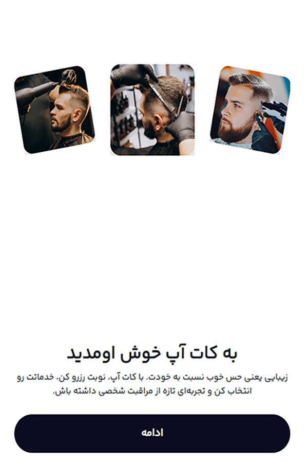
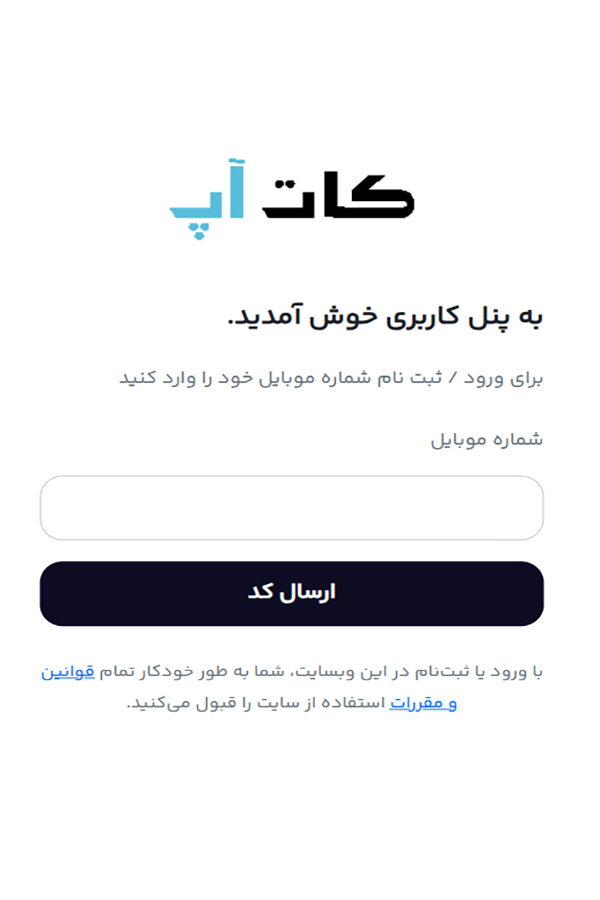
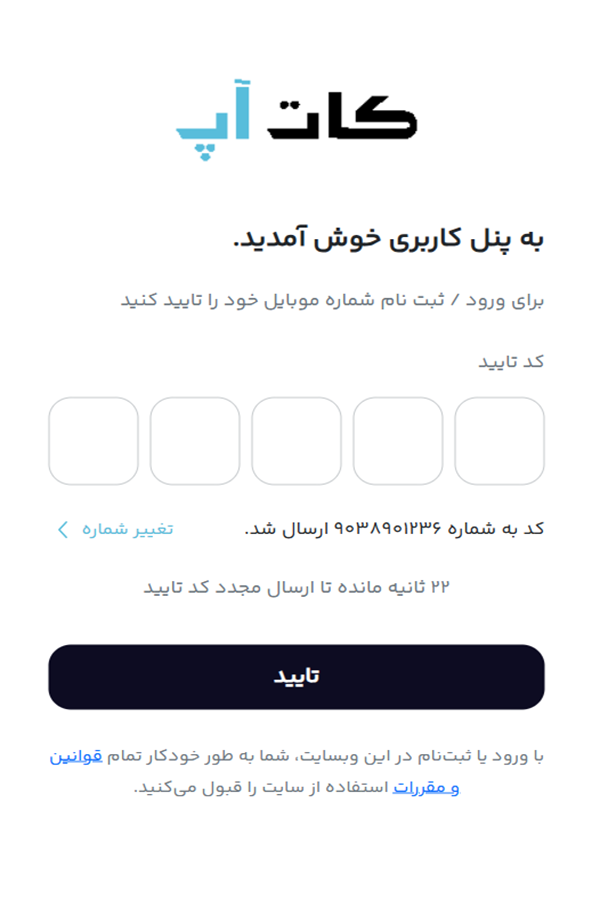
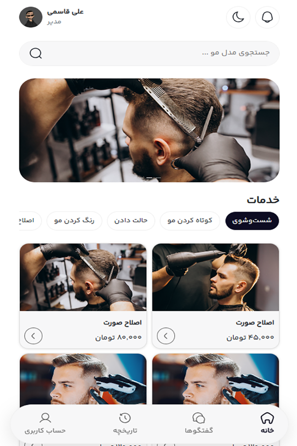
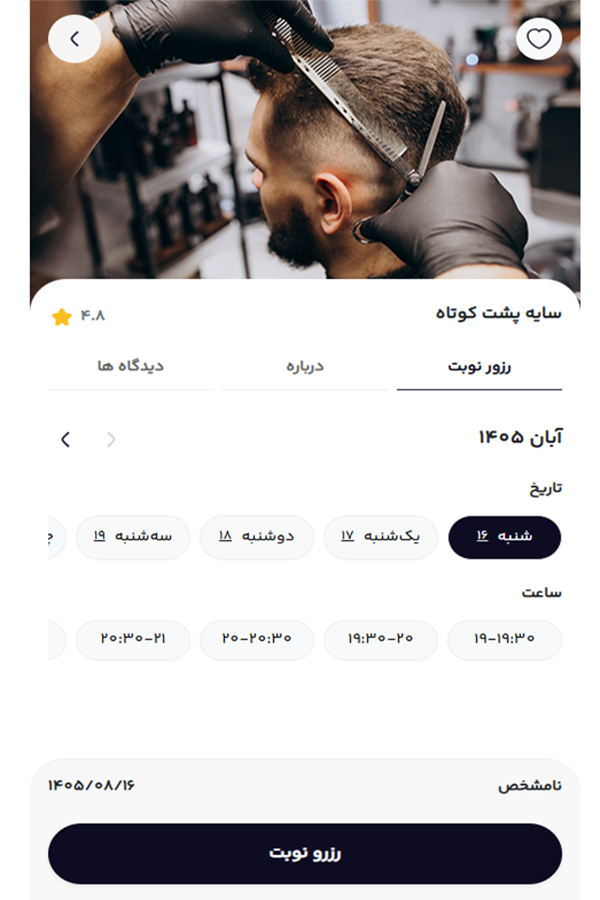
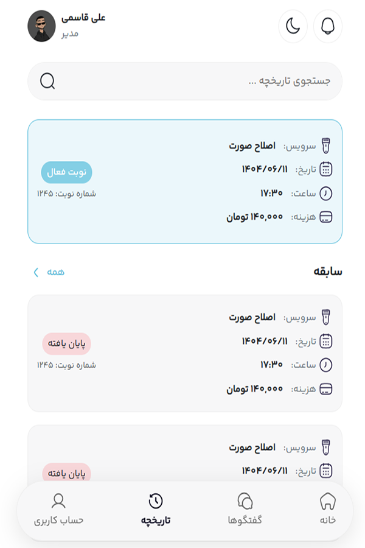
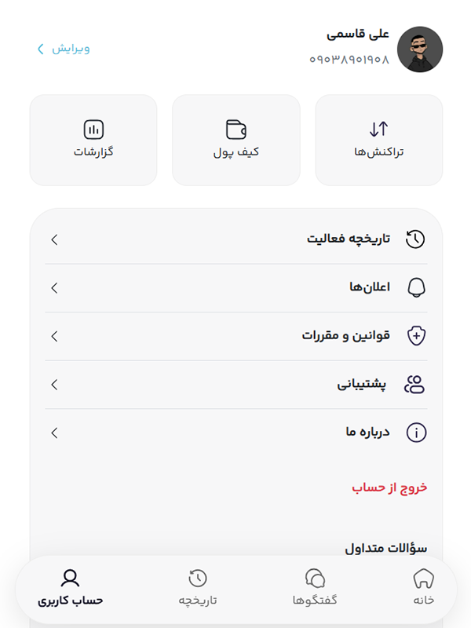

# Barber Appointment Booking

A simple and responsive barber appointment booking interface built with **HTML, CSS, JavaScript, and Bootstrap**.

## Features
- Clean and modern UI
- Responsive design
- Simple appointment booking interface

## Built With
- HTML5
- CSS3
- JavaScript
- Bootstrap

## Preview

## License
This project is open-source and available under the [MIT License](LICENSE).